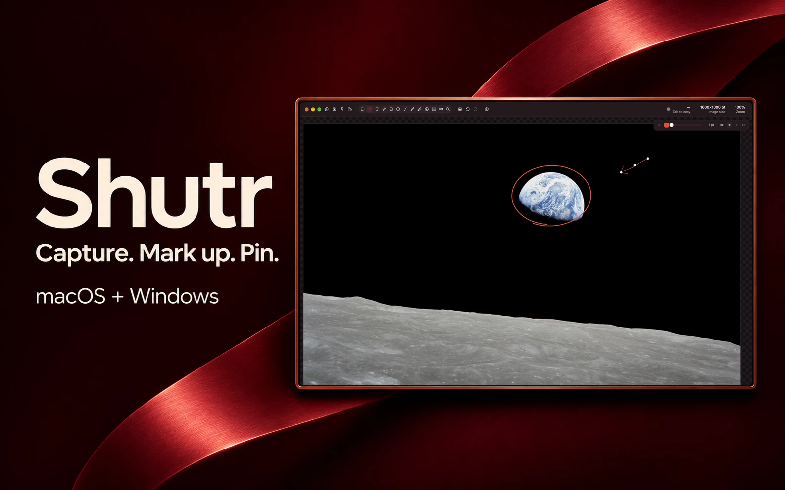

<h1 align="center">Shutr</h1>

  

  <a href="https://abd3lraouf.dev/projects/shutr/">Project page</a>
  ·
  <a href="https://abd3lraouf.dev/press/shutr/">Press kit</a>

## Features

- **Capture** an area, a window, a full screen, or a scrolling page.
- **Annotate** with arrows, shapes, and text. Crop to the area you need or blur sensitive details.
- **Keep it handy** by moving the floating thumbnail with its grip or pinning the image above other windows.
- **Send or reuse it** by copying, saving, or extracting text and QR codes on your device. On macOS, drag the image out of the thumbnail to attach a full-resolution PNG.

## Availability

Shutr is open source under the MIT license. Downloads are available for macOS 15.2 or later on Apple silicon, Windows 10 or 11 on x64, and Ubuntu 24.04 on x64. See the [latest release](https://github.com/abd3lraouf-studios/shutr/releases/latest).

## Artwork

The [product metadata](metadata.json) lists artwork paths relative to this directory and links to the release. The portfolio consumes this directory from its Shutr submodule.

- Brand assets include the [app icon](assets/icon.png) and [editor showcase](assets/cover.webp).
- The [editor tools sheet](assets/tool-showcase.webp) combines two native macOS captures. The unframed [markup and measurement screenshot](assets/editor-screenshot.webp) and [highlight, redact, and crop screenshot](assets/editor-review-screenshot.webp) are available for press use.
- Real Shutr screenshots composited into studio scenes show [selecting a region](assets/capture.webp), [annotating](assets/annotate.webp), and [pinning](assets/share.webp).
- The Earthrise scenes use [Apollo 8’s Earthrise photograph](https://science.nasa.gov/resource/apollo-8s-iconic-earthrise/) by NASA and Bill Anders.

## Attribution

This repository keeps the original authors’ [MIT license](LICENSE).
