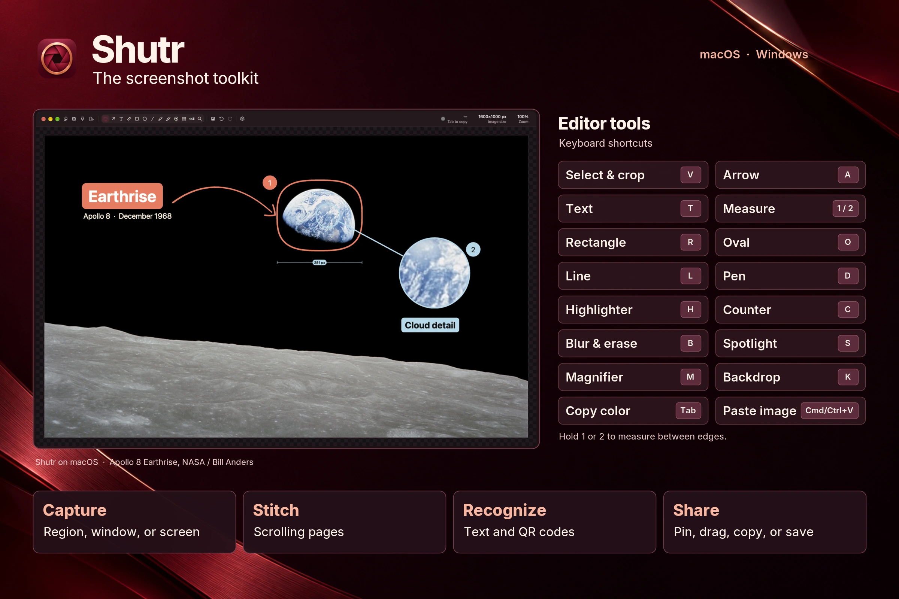

<!-- BEGIN abd3lraouf-studios:hero -->
<h1 align="center">Shutr</h1>

    

    <strong>Capture a screenshot, mark it up, and share it.</strong> 
    macOS 15.2+ (Apple silicon) · Windows 10 or 11 (x64) · Ubuntu 24.04 (x64)

    <a href="https://github.com/abd3lraouf-studios/shutr/releases/latest/download/Shutr.dmg"><strong>macOS →</strong></a>

    <a href="https://github.com/abd3lraouf-studios/shutr/releases/latest/download/Shutr-Setup.exe"><strong>Windows →</strong></a>

    <a href="https://github.com/abd3lraouf-studios/shutr/releases/latest/download/Shutr-linux-x64.deb"><strong>Linux →</strong></a>

    <a href="https://abd3lraouf.dev/projects/shutr/">abd3lraouf.dev/projects/shutr/</a>

<!-- END abd3lraouf-studios:hero -->

  <a href="docs/guide.md">User guide</a>
  ·
  <a href="CHANGELOG.md">Changelog</a>
  ·
  <a href="https://abd3lraouf.dev/press/shutr/">Press kit</a>

Sample photograph by [NASA and Bill Anders](https://science.nasa.gov/resource/apollo-8s-iconic-earthrise/).

Shutr captures an area, a window, a screen, or a page that scrolls, and opens it in an editor for arrows, text, blur, and measurements. Press ⇧⌘2 (Ctrl+Shift+2 on Windows), drag, then press Esc, and the image is on the clipboard.

> [!NOTE]
> Please [open an issue](https://github.com/abd3lraouf-studios/shutr/issues) when something breaks.

## Install

### macOS

1. Download `Shutr.dmg` from the [latest release](https://github.com/abd3lraouf-studios/shutr/releases/latest).
2. Open it and drag Shutr to Applications.
3. Open it. The welcome window asks for Screen Recording, then lets you pick the capture shortcuts and the appearance.

Shutr then lives in the menu bar. Scrolling capture asks for Accessibility the first time you use it.

Shutr needs macOS 15.2 or later on Apple silicon. If you’re installing it manually over an older version under another name, quit the old app first and remove its bundle from Applications after installing Shutr. Your settings carry over.

### Windows

1. Download `Shutr-Setup.exe` from the [latest release](https://github.com/abd3lraouf-studios/shutr/releases/latest).
2. Run it. Shutr is unsigned on Windows, so SmartScreen may stop it the first time. Choose **More info**, then **Run anyway**. It installs for your account without an administrator prompt and upgrades earlier installations, keeping your settings.

Shutr then lives in the tray. It needs Windows 10 or 11 on x64. For a portable copy, unzip `Shutr-windows-x64.zip` into any folder you can write to and run `Shutr.exe`.

Use **Check for Updates…** in the menu bar or tray to look for a newer version.

If you use version 0.3.x, or version 0.6 or earlier on a Mac, download and install Shutr once to move to the current update feed; macOS then asks again for Screen Recording and Accessibility. Your settings carry over. On Windows, running Shutr Setup also replaces an older Start menu shortcut with Shutr.

### Linux

Download `Shutr-linux-x64.deb` from the [latest release](https://github.com/abd3lraouf-studios/shutr/releases/latest) and follow the [Linux guide](docs/linux.md) for installation and capture options on X11 and Wayland.

## Shortcuts

| Action | macOS | Windows |
| --- | --- | --- |
| Capture Area | ⇧⌘2 | Ctrl+Shift+2 |
| Capture Screen | ⇧⌘1 | Ctrl+Shift+1 |
| Recognize Text or QR | ⌃⌥⌘O | Ctrl+Shift+3 |

On macOS, the welcome window and Settings → Hotkeys can move Capture Screen and Capture Area to ⇧⌘3 and ⇧⌘4, and Shutr turns those two off in macOS. On Windows, they can take PrtScn from Snipping Tool instead. Settings → Hotkeys gives every other action a shortcut too.

## What it does

- **Capture.** An area, a screen, a window, a delayed shot, or a scrolling page. The area selection can freeze the screen, and window captures can sit on your wallpaper or on transparency.
- **Edit.** Select and crop, draw arrows and lines, and add text, rectangles, ovals, pen strokes, highlights, and numbered counters. Blur or erase details, spotlight an area, or magnify it. Trim to content and add a backdrop.
- **Measure.** Hold `1` or `2` to measure the distance between edges. Tab copies the color under the cursor.
- **Recognize.** Copy the text or QR code from any area. Recognition runs on your computer.
- **Pin.** Float a screenshot above every window. A pin can be see-through and click-through.
- **Automate.** `--capture area --then copy,save` runs a capture from a script, Shortcuts, or a launcher. See [Automation](docs/guide.md#automation) for the executable paths.

### Editor tools

[Markup and measurement screenshot](assets/editor-screenshot.webp) · [Highlight, redact, and crop screenshot](assets/editor-review-screenshot.webp)

The [user guide](docs/guide.md) covers every hotkey and setting.

## Privacy

Shutr processes screenshots on your computer and sends no telemetry. **Upload to S3** sends the selected image to a bucket you configure and confirm.

<!-- BEGIN abd3lraouf-studios:press -->
## Press & marketing assets

Shutr is a screenshot and markup app for macOS, Windows, and Linux.

**Naming.** Written “Shutr”, one word with an initial capital.

The press kit — icons, screen art, boilerplate, the fact sheet and a downloadable
archive — is at **[abd3lraouf.dev/press/shutr/](https://abd3lraouf.dev/press/shutr/)**.
<!-- END abd3lraouf-studios:press -->

## Artwork

The [product metadata](metadata.json) lists the artwork paths in this repository and links to the release. The portfolio reads this repository as its Shutr submodule.

- Brand assets include the [app icon](assets/icon.png) and [editor showcase](assets/cover.webp).
- The [editor tools sheet](assets/tool-showcase.webp) combines two native macOS captures. The unframed [markup and measurement screenshot](assets/editor-screenshot.webp) and [highlight, redact, and crop screenshot](assets/editor-review-screenshot.webp) are available for press use.
- Real Shutr screenshots composited into studio scenes show [selecting a region](assets/capture.webp), [annotating](assets/annotate.webp), and [pinning](assets/share.webp).
- The Earthrise scenes use [Apollo 8’s Earthrise photograph](https://science.nasa.gov/resource/apollo-8s-iconic-earthrise/) by NASA and Bill Anders.

## Origins and license

Shutr is an independent app inspired by [Shottr](https://shottr.cc/). It began as a fork of [Kiri](https://github.com/Moltenship/kiri) and keeps the original authors’ [MIT license](LICENSE).
